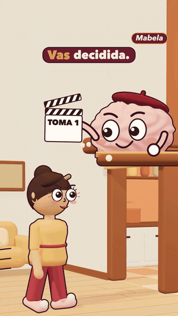
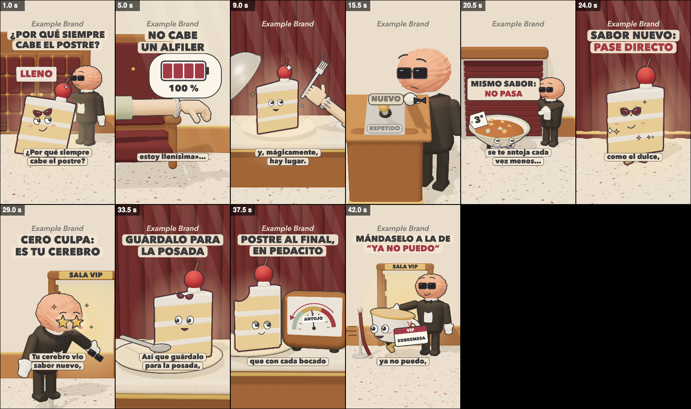

# AI Video Factory

**A production line for short animated videos where every station is held by an AI model, and a person sits exactly where a mistake gets expensive.** Gemini proposes ideas and directs the art, Claude writes and animates the 3D scenes in code, OpenAI models check facts, and scripts handle voice timing and rendering.

<table>
  <tr>
    <td width="32%" align="center"></td>
    <td width="68%"></td>
  </tr>
  <tr>
    <td align="center"><sub>Finished reel (excerpt). Full videos in <a href="media/">media/</a>.</sub></td>
    <td align="center"><sub>Storyboard contact sheet: where the human review happens.</sub></td>
  </tr>
</table>

## The decision that shaped everything

At first I reviewed at the end: "make me a video", then fix what I didn't like. The videos came out technically correct but flat, and fixes were expensive.

| Fixing the same thing… | Cost |
|---|---|
| …in the storyboard (a few coded still frames) | **~$1.20** |
| …in the finished animation | **~$7** |

Measured on this line's own runs; see [docs/overview.md](docs/overview.md) and [docs/cost-analysis.md](docs/cost-analysis.md).

So the human review moved earlier. I don't write the idea or the script: the agents propose topics, hooks and scripts, and I take part in that conversation until they're locked. Then I review the storyboard and a few test shots. Voice sync, animation code and rendering run without me. This case is the core of my essay [The Rising Cost of Judgment](https://github.com/didierguisland/the-rising-cost-of-judgment).

## The line


The route is defined in [`pipeline/video-fabrica.json`](pipeline/video-fabrica.json) (15 stages, US$20 cap per video) and the model cast in [`pipeline/elenco.json`](pipeline/elenco.json).

## Where judgment sits

- **The idea, the hook and the storyboard** are human checkpoints, because that's where a mistake costs the whole video and fixing it costs almost nothing.
- **The correction book.** Every correction I make becomes a written rule with a counter of how many times it has come up (`x3`, `x5`). Reviewer agents apply only the rules that matter for that video and return PASS/FAIL citing the rule. I don't correct the same thing twice. → [docs/correction-book.md](docs/correction-book.md)
- **The visual reviewer is not a gate.** A model reviewing frames said "CHANGE" in 4 out of 4 reviews and once praised improvements that didn't exist. Its notes are triaged; motion and sound are judged by a person.
- **The orchestrator doesn't build or read long files.** 53% of its spending was re-reading context, so it now writes briefs and reads short reports. 18 orchestrator failures are logged with root cause and structural fix. → [docs/failure-log.md](docs/failure-log.md)

## What I decided, what the models did, what a person verified

| | |
|---|---|
| **I decided** | The line, who holds each station, where I sit, and every rule in the correction book. |
| **The models did** | Ideation, scripts, art direction, 3D animation code, fact checks, sound, and first-pass review. |
| **A person verified** | Topic, hook, script, storyboard and test shots; final motion and sound. |

## Numbers, with their limits

- **First full video:** ~US$41.8 in API-equivalent cost (range 37–47). The redesigned line is estimated at **~US$19** per video, based on that one video's measured stage costs and the assumptions listed in the analysis. → [docs/cost-analysis.md](docs/cost-analysis.md)
- **Output:** 12 reels logged for a small wellness account (~160 followers). The best one reached 1,443 views in 5 hours with a 24% three-second drop-off. This is evidence of the method, not of reach. → [docs/results.md](docs/results.md)
- **Model A/B tests** (blind, judged by another model): 3 cases so far, Claude Opus 2, Claude Sonnet 1. Not enough to change anything; the rule is five cases minimum (tracked in [humanify](https://github.com/didierguisland/humanify)).

## Try the render engine

Requirements: Node 20+.

```bash
npm install
npm run render:example   # renders 3 s of the dessert reel to out/dessert-demo.mp4 (1080×1920)
npm run sheet:example    # contact sheet of frames to out/hoja-demo.png
```

Every animation is a single HTML file with a seekable timeline (`window.seek(t)`); the engine captures each frame with Puppeteer and pipes it to ffmpeg.

## Repository

```
pipeline/   the 15-stage route and the model cast (JSON)
engine/     render, contact sheet, camera meter, voice prep, light copy for phones
craft/      working files in Spanish: creative recipe, art-direction brief, rubric, correction book
docs/       English: overview, orchestrator guide, cost analysis, failure log, correction book, pilot
examples/   one complete case: scripts v1–v4, model briefs and replies, storyboard, animation HTML
media/      two finished reels and their contact sheets
```

## Notes

- The videos are in Spanish, made for an account in Mexico. The brand is shown as **Example Brand** in the example case; the two sample reels keep the original account's watermark, with permission.
- Some docs mention orchestration scripts (`humanify.sh`, route engine, scoreboard) that live in [humanify](https://github.com/didierguisland/humanify).
- Voices are synthetic (ElevenLabs Voice Design); no voice files are included.

## License

[MIT](LICENSE) for the code. Three.js is MIT (see `vendor/`). Videos and images in `media/` are © 2026 Didier Guisland, shown as samples; not licensed for reuse.
